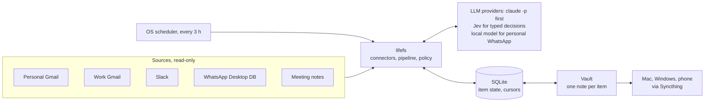

# Architecture

## Components

| Part | Pick |
|---|---|
| Stack | Rust and Tauri 2, one Cargo workspace with a crate per module |
| Process | One binary. An OS-scheduled job runs the app with a `sweep` subcommand. The app window does setup, status and Sweep now |
| Gmail | REST, `gmail.readonly`, `history.list` with a `historyId` cursor, OAuth loopback with PKCE |
| Slack | slack-morphism. An internal app per workspace with a user token, a per-channel `oldest` cursor. `:bookmark:` marks a to-do, `:white_check_mark:` marks it done |
| WhatsApp | A read-only copy of the Desktop `ChatStorage.sqlite`, cursor on `Z_PK` plus a 7-day overlap |
| Meetings | Parse the `%% mc:begin %%` blocks in `areas/meetings/` |
| Pipeline | Rule prefilter, extraction, verifier, quote check, reconcile, closure check, policy in code |
| Connector contract | One `Connector` trait with `fetch`, `thread_context`, `recheck`, closed `Marker` and `AuthKind` enums |
| LLM providers | Harness CLIs (claude-codes, codex-codes, pi-codes, Agent Client Protocol) and HTTP endpoints (rig). jsonschema checks every reply |
| Deciders | TypeSafe Jev from day one, through rig-typesafeai, behind a `Decider` trait. A generative fallback when Jev is down |
| Secrets | A `secrets.toml` file in the app data folder, mode 0600. The Keychain comes later |
| UI | TypeScript and Vite, no framework yet. tauri-specta types the commands |
| Vault format | One note per item with frontmatter, a `todos.base` view, a per-field merge where my edits win |
| Multi-device | One writer at a time on a 4-hour lease. Cursors and state travel as a snapshot in the vault. The Mac is preferred |
| LLM terms | Subscription with "Help improve Claude" off: no training, 30-day retention |

## Design rules

- Read-only on every source. A message cannot trigger an action: the model has no tools and returns
  JSON that code validates.
- Every item carries a verbatim quote and a link to its source. Code checks the quote.
- SQLite is the source of truth. The vault notes are a two-way view.
- My edits win. A field I changed is never rewritten. A deleted note leaves a tombstone.
- Only my tick or an explicit marker closes an item. An inferred closure is a proposal in "Needs
  review".
- Raw messages never enter the vault or this repo.
- Each source has a privacy policy. Personal WhatsApp stays on the Mac's local model.
- Each module asks for its OS permission and downloads its models only when enabled.
- Use an existing library first. Build our own code only when no library fits, and record why.

## Decisions

| Question | Decision (2026-10-17) |
|---|---|
| Name | lifefs for the app, Owed for the to-do module |
| Meeting capture | Merges in as a module later. Separate app until then |
| Connectors | Built into the app with their own auth. No `gws`, `slk` or other local CLIs |
| LLM path | Subscription CLI first, API key as fallback |
| Writer | Moves between the Mac and Windows on a lease. The hub stays out |
| Licence | MIT OR Apache-2.0 |
| First authed source (2026-10-20) | Slack. Work Gmail follows in phase 2 |
| Closures (2026-10-20) | Explicit evidence only. Inferred closures are proposals |
| Jev (2026-10-20) | From day one, with an accepted retention risk |
| Tests (2026-10-20) | None in the first phases. Live testing until the code settles |
| Repo (2026-10-20) | Public on GitHub from day one |
